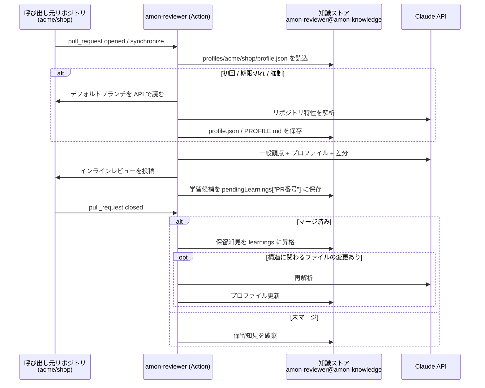

# amon-reviewer

GitHub の Pull Request を Claude でレビューする GitHub Actions 用ミドルウェアです。

- **一般的なレビュー観点**（[prompts/base-perspectives.md](prompts/base-perspectives.md)）をベースにします。
- 各リポジトリから最初に呼ばれたときに、そのリポジトリの**アプリケーション特性を解析**してプロファイルを作ります。
- プロファイルは **amon-reviewer リポジトリ内**（専用ブランチ `amon-knowledge`）に保存され、**次回以降のレビューの前提**として使われます。
- マージされた PR のレビューで得た知見も蓄積していくので、使うほどそのリポジトリ向けのレビューになります。

## 仕組み



| モード | いつ（`mode: auto` 時） | 何をするか |
|---|---|---|
| `review` | `pull_request` の opened / synchronize / reopened / ready_for_review | プロファイルを用意（初回・期限切れ・強制時のみ解析）→ レビュー投稿 → 学習候補を保留領域に保存 |
| `learn` | `pull_request` の closed | マージされていれば保留知見を正式採用。依存定義・スキーマ・インフラ・CI など構造に関わるファイルが変わっていればプロファイルを再解析。未マージなら保留知見を破棄 |
| `analyze` | `workflow_dispatch` / `schedule` / `push` | プロファイルを再解析して保存 |

### リポジトリ解析で見るもの

解析は **GitHub API 経由でデフォルトブランチ**を読みます（未マージの PR コードがプロファイルに混入しないため。呼び出し側で checkout は不要です）。

- ツリー概要（拡張子・ディレクトリ分布、パス一覧）
- ドキュメント：README / CONTRIBUTING / ARCHITECTURE / ADR / CLAUDE.md / AGENTS.md
- 依存定義：package.json, go.mod, pyproject.toml, Gemfile, Cargo.toml, pom.xml, build.gradle など
- ツール設定：tsconfig, ESLint, ruff, golangci, テスト設定, フレームワーク設定
- 実行基盤：GitHub Actions, Dockerfile, compose, Terraform, k8s/Helm
- スキーマ：Prisma, OpenAPI, GraphQL, proto, ORM モデル
- 代表的なソース（エントリポイント、ルーティング、認証、サービス層など）とテスト

### プロファイルの内容

`profile.json` の `profile` には次が入ります（スキーマは [src/profile.mjs](src/profile.mjs)）。

- 概要・アプリ種別・ドメイン・アーキテクチャ・技術スタック・ディレクトリの役割
- コード規約・テスト戦略・セキュリティ上センシティブな領域・重視すべき非機能要件
- **このリポジトリ固有のレビュー重点**（優先度付き）
- **意図的なパターン**（一般論では指摘されがちだが、このリポジトリでは意図的なもの → 誤検知を抑制）
- 用語集・再解析トリガーとなるパス・未解決の疑問

加えて `learnings`（マージ済み PR から得た知見）、`stats`、`history` を保持します。
人が `profile.json` を直接編集・コミットすれば、次回レビューからその内容が前提になります。

## セットアップ

### 1. amon-reviewer リポジトリを用意

このリポジトリを組織内に置き、タグを打ちます（例: `v1`）。知識ストア用ブランチ `amon-knowledge` は初回書き込み時に orphan ブランチとして自動作成されます。

> 知識ストアにはプロファイル（各リポジトリの構成の要約）が保存されます。amon-reviewer リポジトリは **private** にし、閲覧権限を持つ人を、レビュー対象リポジトリを見てよい人に限定してください。

### 2. 知識ストアへの書き込みトークン

呼び出し元の `GITHUB_TOKEN` は amon-reviewer リポジトリに書き込めないため、別途トークンが必要です。推奨は GitHub App です。

1. GitHub App を作成し、権限 **Contents: Read & write** を付与、amon-reviewer リポジトリにのみインストール
2. 呼び出し元（組織）に `vars.AMON_REVIEWER_APP_ID` と `secrets.AMON_REVIEWER_APP_PRIVATE_KEY` を設定
3. ワークフローで `actions/create-github-app-token` によりトークンを発行して `knowledge-token` に渡す

fine-grained PAT（amon-reviewer リポジトリへの Contents: write のみ）でも動作します。

### 3. 呼び出し元リポジトリにワークフローを追加

[examples/caller-workflow.yml](examples/caller-workflow.yml) を `.github/workflows/amon-reviewer.yml` としてコピーし、`your-org` を置き換えます。`secrets.ANTHROPIC_API_KEY` を設定してください。

```yaml
on:
  pull_request:
    types: [opened, synchronize, reopened, ready_for_review, closed]   # closed は学習に必要
permissions:
  contents: read
  pull-requests: write
jobs:
  amon-reviewer:
    runs-on: ubuntu-latest
    steps:
      - id: knowledge-token
        uses: actions/create-github-app-token@v2
        with:
          app-id: ${{ vars.AMON_REVIEWER_APP_ID }}
          private-key: ${{ secrets.AMON_REVIEWER_APP_PRIVATE_KEY }}
          owner: your-org
          repositories: amon-reviewer
      - uses: your-org/amon-reviewer@v1
        with:
          anthropic-api-key: ${{ secrets.ANTHROPIC_API_KEY }}
          knowledge-token: ${{ steps.knowledge-token.outputs.token }}
          knowledge-repo: your-org/amon-reviewer
```

### 4. （任意）リポジトリ固有の追加指示

呼び出し元リポジトリの `.github/amon-reviewer.md` に書いた内容は、レビュー時に追加指示として渡されます。デフォルトブランチから読むため、PR 内で書き換えても そのPR のレビューには影響しません。

## 入力

| 名前 | 既定値 | 説明 |
|---|---|---|
| `anthropic-api-key` | （必須） | Claude API キー |
| `knowledge-token` | （必須） | 知識ストア（amon-reviewer リポジトリ）への書き込みトークン |
| `knowledge-repo` | Action 自身のリポジトリ | 知識ストアのリポジトリ `owner/name`。明示指定を推奨 |
| `knowledge-branch` | `amon-knowledge` | プロファイル保存先ブランチ |
| `github-token` | `github.token` | 対象リポジトリの読み取り・PR 投稿用 |
| `mode` | `auto` | `auto` / `review` / `analyze` / `learn` |
| `model` | `claude-opus-5-5` | 使用モデル |
| `effort` | `high` | `low` / `medium` / `high` / `xhigh` / `max` |
| `language` | `日本語` | コメントの言語 |
| `profile-max-age-days` | `30` | これより古いプロファイルはレビュー前に再解析（`0` で無期限） |
| `force-reanalyze` | `false` | 必ず再解析する |
| `instructions-path` | `.github/amon-reviewer.md` | 追加指示ファイル |
| `ignore-paths` | | レビュー除外 glob（改行/カンマ区切り）。lock ファイル・minified・生成物は既定で除外 |
| `max-findings` | `20` | インラインコメントの上限（超過分はサマリーに掲載） |
| `request-changes-on` | `none` | `critical` / `high` を指定すると、その重大度以上で REQUEST_CHANGES |
| `dry-run` | `false` | 投稿・保存せずログ出力のみ |

出力: `findings-count`, `profile-path`, `profile-updated`

## レビュー結果

- 指摘は差分上の行へのインラインコメントとして投稿されます。差分外を指すものはサマリーに集約されます。
- 🧭 マークはリポジトリ固有のプロファイル/知見に基づく指摘です。
- 適用可能な修正は GitHub の suggestion 形式で付きます。
- 同じ PR への再実行（synchronize）では、既に投稿済みの指摘（ファイル + タイトルの指紋で判定）は再投稿しません。

## 設計上の判断

- **学習はマージ時に確定**：レビュー中に得た知見はいったん PR 番号ごとの保留領域に置き、マージされたものだけ正式採用します。却下された PR の内容や、PR 本文に仕込まれた誘導がプロファイルを汚染することを防ぎます。
- **解析はデフォルトブランチ基準**：レビュー中の PR に構造変更があっても、その時点では再解析せず、マージ後（`learn`）に再解析します。
- **同時実行への耐性**：知識ストアへの書き込みは Git Data API で 1 コミットにまとめ、ref 更新を fast-forward に限定しています。競合した場合は最新を読み直して再適用します。
- **プロンプトインジェクション対策**：PR タイトル・本文・差分・リポジトリ内容はデータとして扱い、指示に従わないよう明示しています。
- **Claude API**：構造化出力（JSON Schema）・ストリーミング・adaptive thinking を使用。プロファイル部分はプロンプトキャッシュの対象です。安全分類器による拒否時は `fallbacks: "default"`（beta `server-side-fallback-2026-07-01`）でサーバー側が推奨モデルにフォールバックします。不要なら [src/claude.mjs](src/claude.mjs) から外してください。
- フォーク PR には secrets が渡らないため、サンプルではフォーク PR をスキップしています。

## 開発

```bash
npm ci
npm test
```

ローカルで試す場合は `GITHUB_EVENT_PATH` にイベント JSON を置き、`AMON_*` 環境変数（[action.yml](action.yml) 参照）と `AMON_DRY_RUN=true` を指定して `node src/index.mjs` を実行します。

```
src/
  index.mjs           エントリポイント（モード振り分け）
  config.mjs          入力の読み取りと検証
  github.mjs          対象リポジトリの GitHub API 操作
  knowledge-store.mjs amon-reviewer 内の知識ストア（プロファイル保存）
  repo-analyzer.mjs   リポジトリ特性の解析
  profile.mjs         プロファイルのスキーマ・鮮度判定・知見管理・レンダリング
  reviewer.mjs        レビュー（プロンプト・出力スキーマ・投稿整形）
  diff.mjs            差分の行番号処理
  claude.mjs          Claude API クライアント
prompts/
  base-perspectives.md 一般的なレビュー観点
```
